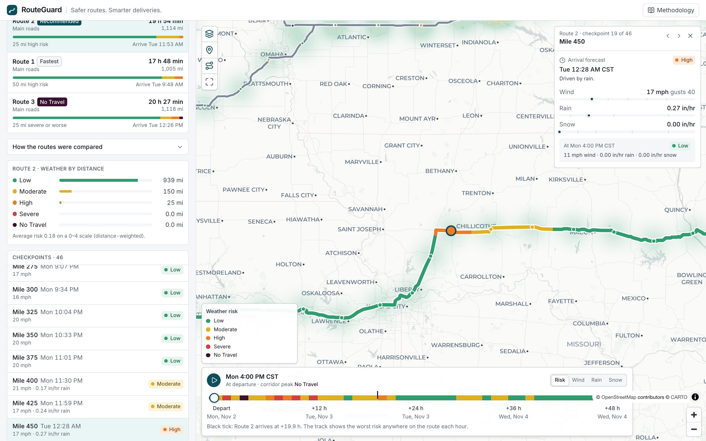
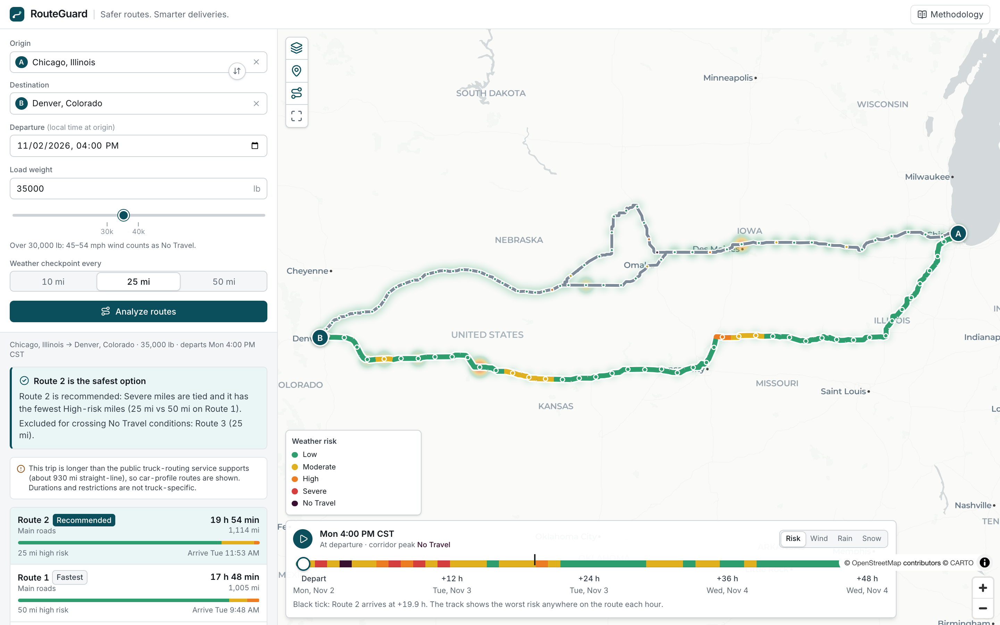
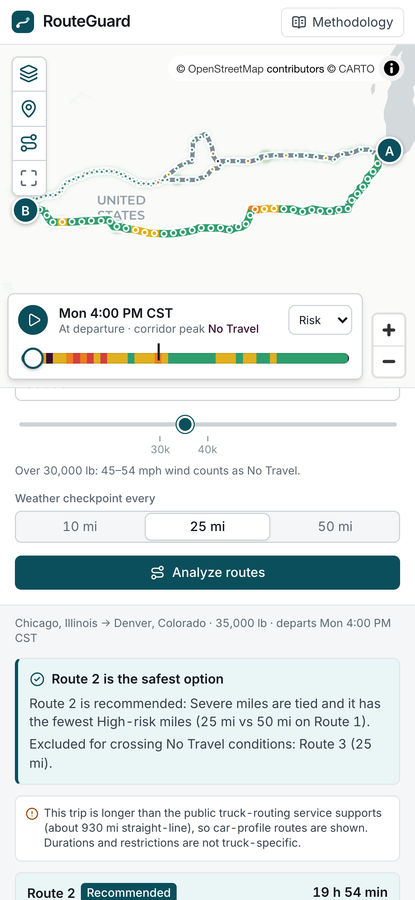
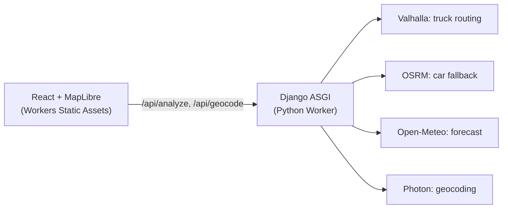

# RouteGuard

**Safer routes. Smarter deliveries.**

RouteGuard helps a truck driver or dispatcher choose between route alternatives using the weather the truck will actually
meet. Enter an origin, destination, departure time and load weight. RouteGuard finds up to three routes, places weather
checkpoints along the real road, forecasts conditions at the truck's estimated arrival at each one, applies the load-aware
risk rules, and recommends a route, with its reasoning shown.

* **Live app:** https://routeguard.buildwithanthony.com
* **API:** https://routeguard-api.buildwithanthony.com (`/api/health`)
* Built for the Spotter AI full-stack assessment (React + Django).



<details><summary>More screenshots</summary>





</details>

## What it does

* Address/place search, departure date and time (origin local time), load weight, and a 10 / 25 / 50 mile checkpoint interval.
* Up to **three route alternatives** on a map, each with distance, duration, arrival, and a distance-by-risk breakdown.
* **Checkpoints every 10/25/50 road miles** (placed along the routed geometry), each with an ETA, the forecast for that
  hour, a risk level and the reason for it. Click one on the map or in the list.
* **Load-aware risk** from the provided thresholds, including the 30,000 lb and 40,000 lb wind escalations.
* A **recommendation** with visible reasoning and a side-by-side view of the four priorities.
* A **weather heatmap** along the corridor with a **0-48 hour forecast slider**: the track is painted with the worst risk on
  the route each hour, shows the arrival hour, can play back, and switches between risk, wind, rain and snow.

## Run it locally

Prerequisites: Node 22+, [uv](https://docs.astral.sh/uv/), Python 3.13 (uv installs it).

```bash
# terminal 1: Django API on :8000
cd backend
uv sync
DJANGO_DEBUG=1 uv run python manage.py runserver 8000

# terminal 2: React app on :5173 (proxies /api to :8000)
cd frontend
npm ci
npm run dev
```

No API keys are needed. See `.env.example` for the few settings that exist.

```bash
# checks
cd backend  && uv run ruff check . && uv run pytest
cd frontend && npm run lint && npm run typecheck && npm test && npm run build
cd frontend && npx playwright install chromium && npx playwright test   # starts its own servers
```

## Stack

React 19, Vite, TypeScript, Tailwind CSS 4, MapLibre GL JS, Lucide icons. Django 5 (async views, ASGI) on Cloudflare
Python Workers. Pytest, Vitest + Testing Library, Playwright. GitHub Actions. No database.

## Architecture



The Django code is split so the decisions that matter are pure and testable: `domain/` (risk, geometry, sampling,
ETAs, stats, ranking), `services/` (providers and the trip use case), `api/` (transport). More in
[docs/architecture.md](docs/architecture.md); the JSON contract is in [docs/api.md](docs/api.md).

## Providers

| Need | Provider | Why |
| --- | --- | --- |
| Routing | [Valhalla](https://valhalla1.openstreetmap.de) public server, `truck` costing | Honours vehicle weight, height and width. No key. Limited to ~930 mi straight-line. |
| Routing fallback | [OSRM](https://router.project-osrm.org) public server | No distance limit and exact per-segment durations, but **car profile**. |
| Forecast | [Open-Meteo](https://open-meteo.com) | Hourly wind, rain, snowfall in mph / inches, batched multi-location, 15-day horizon. No key. |
| Geocoding | [Photon](https://photon.komoot.io) | Addresses and places. No key. |
| Basemap | CARTO Positron (OpenStreetMap data) | Light, quiet style for overlays. No key. |

**Truck routing disclosure.** Trips within Valhalla's limit use a truck profile (an assumed 5-axle tractor-trailer: 13.5 ft
high, 8.5 ft wide, 33,000 lb empty plus your load). Longer trips are routed with OSRM's **car** profile, and the UI says
so; durations and restrictions for those trips are not truck-specific.

## Risk calculation

Each checkpoint is classified by its **highest** hazard.

| Condition | Low | Moderate | High | Severe | No Travel |
| --- | --- | --- | --- | --- | --- |
| Wind (mph) | < 25 | 25-34 | 35-44 | 45-54 | >= 55 |
| Rain (in/hr) | < 0.10 | 0.10-0.25 | 0.25-0.50 | 0.50-1.00 | > 1.00 |
| Snow (in/hr) | < 0.5 | 0.5-1.0 | 1.0-2.0 | 2.0-3.0 | > 3.0 |

Load rules (strictly greater than): wind 45-54 mph and load > 30,000 lb is **No Travel**; wind 35-44 mph and load
> 40,000 lb is **Severe**; wind >= 55 mph is No Travel at any weight.

Interpretations, all pinned by tests:

* Ranges share endpoints, so every level starts at its lower bound (inclusive): a boundary value takes the **more severe**
  class. Rain "> 1.00" and snow "> 3.0" are strict, so exactly 1.00 and 3.0 remain Severe.
* Missing data is **unknown**, never assumed safe. Unknown miles are excluded from risk and shown separately.
* Wind uses sustained 10 m speed; gusts are displayed but not scored. Rain is rain + showers; snow is snowfall depth per hour.

## Route recommendation

Strict lexicographic order, not a weighted score:

1. Fewest **Severe** miles
2. Fewest **High** miles
3. Lowest distance-weighted **average risk** (Low 0 ... No Travel 4)
4. Shortest **travel time**

A later criterion only matters when every earlier one ties, so speed can never offset Severe weather. The assessment does not
rank No Travel, so it is treated conservatively: a route with any No Travel miles is compared first and is **never recommended
as safe**. If every route has some, RouteGuard says "No safe route at this time" and points to the forecast slider.

## Weather sampling and ETAs

1. Decode the route's road geometry and place checkpoints at 0, N, 2N ... miles plus the destination, by interpolating along
   the polyline (distance scaled to the provider's reported mileage). Never the straight line.
2. ETA = departure + the provider's driving time at that point (per-maneuver / per-segment times), so slow sections delay
   later checkpoints.
3. Read the forecast for the nearest hour to each ETA, in UTC. A departure typed without an offset is wall-clock time at the
   origin (DST-aware); times are displayed in the origin's timezone.
4. Each checkpoint represents the road halfway to its neighbours, so mileage and averages are distance-weighted and sum to
   the route length exactly.

The 0-48 h slider re-reads the same checkpoints at departure + h hours (so the heatmap is a corridor snapshot), while risk
and ETAs always use the truck's actual arrival time.

## Testing

* **230 backend tests** (pytest): thresholds and exact boundaries, load rules, missing data, interval generation,
  interpolation on bent roads, ETAs, mileage, ranking, routing selection, forecast parsing/caching/horizon, DST, the HTTP API.
* **86 frontend tests** (Vitest + Testing Library): forms, validation, combobox keyboard use, route selection, risk summaries,
  forecast controls, loading/error states, state and map-data derivation.
* **20 Playwright tests** in a real browser against the production build and the real Django API with scripted fake weather
  (deterministic): planning, route switching, checkpoint inspection from list *and* map, the slider/keyboard/playback, layer
  data actually drawn by MapLibre, heavier load turning Severe into No Travel, error recovery, and a phone viewport.
* **3 post-deploy smoke tests** against the live site and providers.

## CI/CD

[`.github/workflows/ci.yml`](.github/workflows/ci.yml) runs on pushes and pull requests: backend (ruff, strict
`check --deploy`, pytest), frontend (eslint, tsc, vitest, build), and Playwright. On `main`, once all three pass, it deploys
the API with `pywrangler` and the web app with `wrangler`, waits for the health check, and runs the smoke test. Cloudflare
credentials come from the `CLOUDFLARE_API_TOKEN` and `CLOUDFLARE_ACCOUNT_ID` repository secrets; the job skips with a warning
if they are absent (e.g. fork PRs). GitHub Actions is the only deployment mechanism (no Cloudflare Git integration).

## Deployment

| Worker | What | Config |
| --- | --- | --- |
| `routeguard-web` | Vite build served by Workers Static Assets (SPA fallback) | `frontend/wrangler.jsonc` |
| `routeguard-api` | Django on Python Workers | `backend/wrangler.jsonc`, `backend/src/entry.py` |

The browser calls the API cross-origin; `CORS_ALLOWED_ORIGINS` and `DJANGO_ALLOWED_HOSTS` are Worker vars, and
`DJANGO_SECRET_KEY` is a Cloudflare secret (`uv run pywrangler secret put DJANGO_SECRET_KEY`). The API refuses to start
without it when `DEBUG` is off. The frontend is built with `VITE_API_BASE_URL` pointing at the API.

## Known limitations

* Public, key-less providers have no SLA and fair-use limits. Valhalla's server caps trips at ~930 mi (car-profile OSRM
  beyond that). Open-Meteo's free tier is rate limited per IP; forecasts are cached for 15 minutes and requests are batched.
* The road network often offers fewer than three genuinely distinct routes; RouteGuard shows what it finds.
  Waypoint-forced alternatives are real roads but are not a substitute for a provider's alternatives.
* Forecast resolution is hourly and roughly 10 km. A narrow squall line between checkpoints can be missed; 10-mile
  sampling reduces that. Departures are limited to 14 days; ETAs past the 15-day horizon are unscored.
* The vehicle is assumed (tractor-trailer, 33,000 lb tare); height/weight restrictions come from OSM data.
* Durations of the car-profile fallback are optimistic for trucks.
* **Cloudflare Workers Free plan CPU budget.** Python Workers run on Pyodide, which is slow at tight loops, and the Free plan
  cannot raise the CPU limit. Roughly 1 in 10 to 15 analyses in live testing hit the limit (Cloudflare error 1102, no JSON
  body). The app mitigates it (routing and forecast caches, de-duplication before decoding geometry, array-based timelines,
  compact JSON, and one automatic client retry with a "busy" message), but does not eliminate it. Moving `routeguard-api`
  to a Workers Paid plan (`limits.cpu_ms`) removes the ceiling; this was not done because it is a paid change.
* The free Open-Meteo tier rate-limits per IP (a 10-mile analysis of a long trip uses several hundred locations);
  the API reports it as `weather_rate_limited` and the UI offers a retry.
* This is decision support, not dispatch authority. No traffic, closures or incidents are considered.

## Design decisions

Light, neutral, map-first workspace with a deep-teal accent; risk is always colour **and** text; No Travel stretches are
also dashed on the map. Every control does something: the load slider marks the 30k/40k thresholds, the timeline track is
data, the comparison table highlights the criterion that decided the result. Keyboard support throughout (combobox, radio
groups, slider, inspector stepping, `Esc`). Rationale and trade-offs: [docs/architecture.md](docs/architecture.md).

## Assessment checklist

| Requirement (PDF) | Status |
| --- | --- |
| Origin and destination, departure date/time, load weight inputs | Done |
| Generate 3 route options using a routing API | Done: up to 3 from Valhalla/OSRM; fewer shown honestly when the network offers fewer |
| Sample weather every 10 / 25 / 50 miles using the truck's ETA at each checkpoint | Done |
| Weather risk from the provided risk and load rules | Done, with boundary tests |
| Recommend the best route balancing weather risk and travel time (priority order) | Done: lexicographic, No Travel treated as a veto |
| Show routes, checkpoints, risk levels, ETAs and route summaries on a map | Done |
| Weather heatmap along the corridor with a 0-48 h forecast slider | Done |
| GitHub repository, hosted application | Done |
| Video walkthrough | Linked at the top of this README |

Time budget: well inside the 16 h / 4 day limit.
