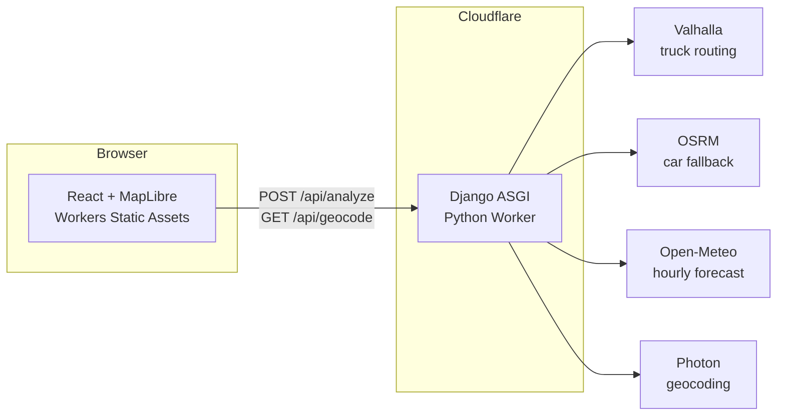

# Architecture and decisions

## Backend layout (`backend/src`)

| Package | Responsibility | Depends on |
| --- | --- | --- |
| `domain/` | Pure logic: risk classification, geometry, checkpoint sampling, ETAs, route stats, ranking, explanations | stdlib only |
| `services/` | I/O: HTTP abstraction, Valhalla/OSRM, Open-Meteo, Photon, the trip use case (`planner.py`) | `domain` |
| `api/` | Django transport: request parsing, serialization, views | `domain`, `services` |
| `routeguard/` | Django project (settings, urls, asgi) | |
| `entry.py` | Cloudflare Worker entrypoint | |

The risk engine (`domain/risk.py`) and ranking (`domain/recommend.py`) import nothing from Django or the network, so
they are unit-tested in isolation and cannot be affected by transport concerns.

## Decisions

**Django ASGI on Cloudflare Python Workers.** Verified on a real deployment before building anything else. Two runtime
issues were found and handled in `entry.py`: Pyodide cannot start OS threads, so asgiref's thread pool is replaced with an
inline executor (Django's ASGI handler pushes `response.close()` through it), and outbound HTTP must use the runtime's
`fetch`. Async views are used so provider calls run concurrently (`asyncio.gather`). DRF is not used: it has no async
views, and the API is two endpoints. No database, sessions, auth or queues.

**Keyless providers.** No API key was available, and shipping a demo that needs a reviewer to sign up for one is worse than
documenting provider limits. Valhalla (truck costing, honours vehicle weight/height/width), OSRM, Open-Meteo and Photon
need none. The only secret is Django's `SECRET_KEY`, stored as a Cloudflare secret; the app refuses to start without it
when `DEBUG` is off. Providers sit behind small functions in `services/`, so swapping in HERE or ORS is local.

**Getting up to three routes honestly.** Public routing servers return one or two alternatives for most trips. Candidates are
gathered from the engine's own alternates, a `shortest` profile, and two routes forced through waypoints either side of the
trip's midpoint. They are de-duplicated by geometry overlap, dropped if they backtrack (a spur to the waypoint and back) or
exceed 1.35x the fastest time, and capped at three. If the network only offers two, two are shown and the UI says so.

**Truck vs car.** Valhalla's public server rejects trips over ~930 mi straight-line. Longer trips use OSRM, which is a car
profile; this is disclosed in the response (`meta.routing.profile`), in the UI, and in the README. Durations for those
trips are car durations.

**Checkpoints follow the road.** Positions come from interpolating along the decoded route geometry by cumulative
distance (scaled to the provider's reported mileage), never the origin-destination chord. ETA at each checkpoint is read
from the provider's per-vertex driving-time profile (Valhalla maneuver times, OSRM per-segment durations), so slow
mountain sections delay later checkpoints correctly.

**Distance-weighted statistics.** A checkpoint represents the road halfway to its neighbours on both sides, so segments tile
the route exactly and "Severe miles" and average risk are real mileage, not checkpoint counts.

**Boundary rule.** The assessment's ranges share endpoints (rain "0.10-0.25" and "0.25-0.50"). Every level starts at its
lower bound, inclusive, so a boundary value takes the more severe class. Rain and snow "No Travel" are explicitly
"greater than" 1.00 / 3.0, so those values stay Severe. Tests pin each boundary.

**No Travel is a veto, not a rank.** The assessment's four priorities do not mention it. A route with any No Travel miles
is compared first and never presented as safe; if all routes have some, the status is `all_prohibited` and the UI says no
route is safe at that time.

**Lexicographic ranking.** Python tuple comparison over `(no_travel, severe, high, avg_risk, duration)` with values
rounded only to remove float noise. There is no weighted score, so speed can never buy back Severe miles.

**Time zones.** A departure typed without an offset is wall-clock time at the origin, converted with `zoneinfo`
(`tzdata` is bundled for Pyodide), so DST is handled. Forecast hours are requested in UTC with Unix timestamps. The UI
formats every time in the origin's zone with its abbreviation.

**Forecast sampling.** The forecast for the nearest hour to each ETA is used (Open-Meteo hourly values: wind is
instantaneous, precipitation is the preceding hour's accumulation, which equals an in/hr rate). Rain is `rain + showers`.
Departure is limited to 14 days so the 0-48 h window stays inside the provider's 15-day horizon; ETAs beyond it are
"no forecast", excluded from risk and shown as unscored miles.

**Efficiency.** Forecast requests batch up to 100 locations, snap to a ~1 km grid, are limited to the needed time window,
and are cached for 15 minutes per isolate, so changing only the load weight re-scores without new provider calls. Dense
provider geometry is thinned (0.25 mi) with a flat-earth distance before the trig-heavy work, because Pyodide is slow at
tight Python loops. Risk classification of the 49-hour timelines is memoised. The frontend lazy-loads MapLibre, identical
requests are de-duplicated and stale ones aborted, and map layers update through `setData` on memoised GeoJSON.

**Runtime budget.** Pyodide on the Workers Free plan has a CPU ceiling that live testing showed is reachable on heavy
trips, so the API runs on Workers Paid with `limits.cpu_ms = 30000`. Measures that reduce the load regardless: routing results cached 15 min (re-analysis with a new load/departure/interval does no routing work),
provider routes de-duplicated by length and time before geometry is decoded, corridor-waypoint candidates requested only when
needed, a byte-level polyline decoder, 49-hour timelines built with slices (tested equivalent to per-hour sampling), compact
JSON, straggler calls abandoned 5 s after the first success, and a client retry for platform 5xx. Residual risk is the free Open-Meteo rate limit, reported as `weather_rate_limited`.

## Testing strategy

* **Backend (230 tests):** thresholds and exact boundary values, load rules, missing data, interval generation,
  interpolation along bent roads, ETA from the time profile, distance-weighted mileage, ranking order and float noise,
  routing selection/dedup/backtracking, forecast parsing/windowing/caching/horizon, timezone/DST, and the HTTP API with a
  fake upstream. No test touches the network.
* **Frontend (86 tests):** validation, form behaviour, combobox keyboard handling, route selection, risk summaries,
  forecast controls, inspector, loading/error states, reducer and map-data derivation, API client and hook behaviour.
* **E2E (20 Playwright tests):** real browser, production build, real Django API, scripted fake weather. Asserts what
  MapLibre actually draws, load-weight escalation, slider/keyboard/playback, errors, and a phone viewport.
* **Smoke (3 tests, after each deploy):** deployed web and API with live providers.
